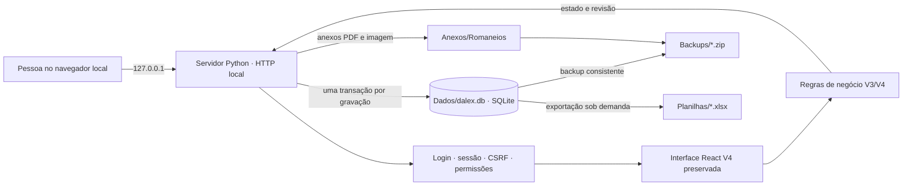

# Arquitetura local do VIEX ERP

## Caminho de uma operação



O serviço usa `HTTPServer` ligado exclusivamente a `127.0.0.1`. A fila única de requisições é adequada ao uso local de uma pessoa por vez e também impede que uma solicitação concorra com a substituição do banco durante uma restauração.

## Decisões de implementação

- **Interface:** a tela principal usa React/TypeScript e é servida localmente pelo Python. O iniciador do Windows usa Tkinter para exibir o estado do serviço e a ação de abrir o navegador. O aplicativo não chama serviços externos. As regras de faturamento, parcelas, recebimentos, produção, funcionários e oficinas continuam no domínio versionado em `src/v3` e `src/v4`.
- **Persistência:** `src/v4/store.ts` escolhe a API local quando a versão Python está ativa. `backend/database.py` grava por meio de uma transação SQLite e confere a revisão esperada. Valores financeiros são guardados em centavos.
- **Integração gradual:** tabelas relacionais impõem vínculos e índices; os registros principais também mantêm o estado JSON da V4 para preservar formulários e histórico durante esta conversão. Isto permite evolução incremental, mas não representa ainda um modelo totalmente normalizado.
- **Autenticação:** as senhas usam scrypt com salt individual. A sessão fica no processo local, com cookie `HttpOnly`, `SameSite=Strict`, expiração renovável e token CSRF para gravações. Não há login Google nem serviço remoto.
- **Permissões:** Administrador pode usar todos os módulos; Operação pode registrar atividades sem receber valores e dados bancários; Consulta não grava. A API repete os bloqueios do perfil no servidor, sem confiar apenas na interface.
- **Auditoria:** registros antigos não podem ser apagados ou reescritos. O servidor identifica o usuário autenticado nos novos eventos. Baixas desfeitas permanecem registradas; notas e snapshots financeiros não podem ser alterados, exceto a previsão editável de uma parcela.
- **Arquivos:** anexos têm nome de apresentação separado de um identificador aleatório usado no caminho do disco. Há limite de 5 MB, tipos aceitos restritos e verificação da assinatura do arquivo. O banco guarda o vínculo; os bytes ficam sob `Anexos`.
- **Excel:** é uma exportação administrativa sob demanda, gerada do SQLite como um único `.xlsx` com abas por área. Não existe sincronização de volta da planilha para o banco.
- **Backup:** é um ZIP com snapshot SQLite pela API de backup do próprio SQLite, anexos e configurações. A restauração valida o arquivo, as tabelas e a integridade antes de trocar o estado; também cria uma cópia do estado anterior.
- **Caminhos:** em execução Python, os dados ficam dentro da pasta do aplicativo. No pacote PyInstaller futuro, a interface ficará no pacote de recursos e os dados ao lado de `VIEX.exe`. O empacotamento ainda não foi executado.
- **Esquema:** cada banco registra `schema_version` e `schema_migrations`. A versão atual inicia bancos novos e rejeita bancos mais novos. Não existe ainda uma migração entre versões distribuídas; essa rotina precisa de cenário e teste antes de uma atualização real.

## Pastas usadas

```text
D'ALEX ERP/
├── VIEX.py
├── backend/                 serviço, SQLite, backup e exportação
├── dist/                    interface React compilada
├── Dados/dalex.db           banco principal
├── Anexos/Romaneios/        PDFs e imagens ligados aos romaneios
├── Backups/                 cópias ZIP manuais e automáticas
├── Planilhas/               exportação Excel atual
└── Configuracoes/           arquivos de configuração locais
```

`Dados`, `Anexos`, `Backups`, `Planilhas` e `Configuracoes` são permanentes. `dist` faz parte da versão local porque o Python serve os arquivos já compilados. `node_modules` e Node.js servem somente para preparar ou recompilar a interface.

## Limites conhecidos

- O login controla as telas e operações dentro do aplicativo; o arquivo SQLite não é criptografado em repouso. A conta Windows e as cópias externas precisam ser protegidas.
- Sessões são encerradas quando o serviço Python fecha ou após oito horas sem atividade.
- Ainda é necessário testar atualizações de esquema sem perda de dados; esta versão deve ser usada apenas para dados fictícios durante a validação.
- A transferência foi verificada em outra pasta no mesmo Windows de desenvolvimento, não em uma segunda máquina Windows limpa.
- O pacote `.exe` ainda não foi produzido. `DALEX.spec` e `GERAR_EXE.bat` preparam uma distribuição de pasta única quando esse passo for autorizado.
