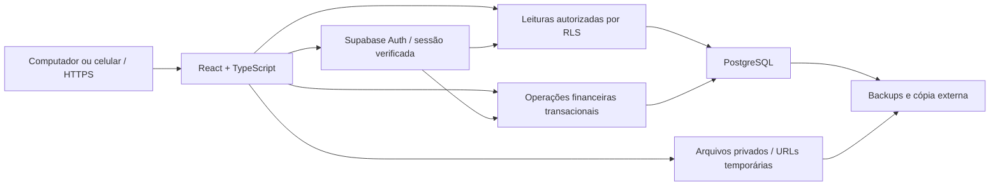

# D’ALEX Simple ERP — Finalização do protótipo V4 e proposta de implantação

Data: 29/10/2026. Situação: protótipo local aprimorado, distribuição de demonstração preparada e arquitetura definitiva somente planejada. Nenhum banco real ou serviço pago foi contratado.

## 1. Resultado desta entrega

O botão de recolher/expandir foi movido para o topo, junto à marca. Ícones permanecem visíveis e o menu móvel pode ser expandido sem aumentar a largura da página. A Visão Geral e os demais fluxos aprovados foram mantidos.

Mensagens de validação são limpas ao corrigir campos, fechar formulários ou navegar. Os bloqueios de recebimento superior ao saldo continuam ativos.

Editar quantidades de um lote ainda sem vínculo financeiro preserva os preços dos códigos mantidos, desde que o cliente e a origem continuem iguais. Receita e custo de oficina são recalculados e aparecem antes de confirmar. Códigos novos continuam precisando de preço; trocar cliente/origem exige nova negociação. NF e pagamentos ativos continuam protegendo quantidades, preços e exclusão.

O histórico passou a registrar diferenças por código: quantidade, unitário do cliente, total do cliente, unitário da oficina e custo total, sempre com anterior/novo. Há responsável, perfil, origem da identidade e data/hora. Corrigir novamente ou desfazer um pagamento acrescenta outro evento; não apaga o original. Eventos antigos sem responsável conhecido são apresentados como legado, sem atribuir uma identidade retroativamente.

## 2. Permissões: o que está pronto e o que ainda depende do servidor

Foi criada uma política central e uma matriz conservadora para teste:

| Perfil | Escopo de demonstração |
|---|---|
| Administrador | Todos os módulos, valores, cadastros e operações financeiras. |
| Operação | Visão operacional e cadastro/edição permitida de romaneios. Não vê valores, não define preços, não fatura e não registra pagamentos. |
| Consulta | Leitura operacional, sem gravações nem valores financeiros. |

A seleção em **Perfil → Perfil de teste** permite verificar os três perfis. Ela é intencionalmente livre nesta demonstração e **não autentica uma pessoa**. A identidade do histórico é a identidade simulada selecionada, não prova da identidade real do operador.

Há proteção de apresentação e validação de transições na aplicação. Isso prepara o contrato para o futuro servidor, mas um HTML/JavaScript entregue ao navegador não pode proteger dados reais contra quem controla aquele navegador. Por isso a versão compartilhável contém somente exemplos fictícios. Dados financeiros reais só devem entrar após autenticação e autorização de banco/servidor verificadas.

## 3. Testes executados

- TypeScript estrito e compilação de produção local.
- 74 testes automatizados de regras/persistência/política, incluindo regressão das versões anteriores e novos testes de quantidade, custo, auditoria e autorização.
- Percurso de regressão V4 com cadastros, conclusão interna/externa, NF sem previsão, previsão editável, ordenação, pagamentos/desfazimentos, exportação, migração e paginação de 200 romaneios no mês.
- Teste final de menu, limpeza de erros, preço preservado/revisão, histórico com responsável, perfis e menu móvel.
- HTML independente aberto por `file://` no Edge, cadastro salvo e recuperado após recarga, sem requisições HTTP externas.
- Link público verificado sem autenticação, com exemplos de fábrica, restrições de perfil e apresentação móvel.

Os testes usam perfis temporários e dados fictícios. Viewport móvel não equivale a teste em aparelho físico. Segurança de banco, concorrência multiusuário, envio de e-mail, emissão fiscal, transações bancárias e restauração de backups reais não foram executados porque ainda não existem nesta fase.

Consulte `VALIDACAO_FINAL_V4.md` para os resultados, evidências e limites finais.

## 4. Acessar e compartilhar

### Desenvolvimento local

Abra http://127.0.0.1:5180/ ou execute `INICIAR.cmd` nesta pasta. Esse endereço é deste computador; não é um endereço público para terceiros.

### Arquivo único, sem ferramentas de desenvolvimento

Distribua **`release/DALEX-ERP-V4-DEMONSTRACAO.html`**. A pessoa abre no Edge/Chrome; não precisa de Node.js, terminal, dependências ou várias pastas. Código e estilos estão incorporados. O pacote não inclui exportações de seus testes, credenciais ou armazenamento do navegador de origem.

Cada navegador mantém seus próprios exemplos e alterações. A demonstração usa uma chave de armazenamento diferente da V4 de desenvolvimento e nunca migra cadastros locais antigos para a distribuição. Quando o navegador bloqueia armazenamento, a demonstração pode manter os dados apenas durante a sessão. Os dados não são sincronizados entre pessoas.

Em celulares, prefira a versão hospedada: alguns visualizadores de arquivos do aparelho não executam aplicações HTML. A interface responsiva foi verificada por navegador com viewport móvel; não foi verificado todo aplicativo de arquivos de iOS/Android.

### Link por navegador

**Demonstração publicada, com acesso público autorizado:** [abrir D’ALEX ERP — V4](https://dalex-erp-v4-demonstracao.spicyclove20.chatgpt.site).

A publicação foi confirmada pelo serviço Sites. Foi publicado somente o HTML da demonstração isolada, com exemplos fictícios, sem banco externo ou credenciais. Quem recebe o link não precisa instalar ferramentas. Cada navegador mantém seus próprios testes; não há sincronização entre avaliadores. Isso é uma publicação do protótipo, não a implantação definitiva do ERP.

Os arquivos estáticos também ficam em `release/static`, e o ZIP é adequado para upload único em outra hospedagem escolhida futuramente. Nenhuma assinatura paga de infraestrutura foi contratada nesta entrega.

Uma opção para publicação futura é Cloudflare Pages com upload de arquivos prontos, sem instalar ferramentas no computador de quem testa. As requisições de arquivos estáticos são gratuitas dentro do modelo documentado; funções, produtos adicionais e serviços pagos não são necessários para esta demonstração. [Upload direto](https://developers.cloudflare.com/pages/get-started/direct-upload/), [preços de arquivos estáticos](https://developers.cloudflare.com/pages/functions/pricing/).

## 5. Arquitetura definitiva recomendada

**Manter React + TypeScript + Vite no cliente e adotar Supabase gerenciado: PostgreSQL, Auth e Storage privado.** Não há necessidade proporcional de reescrever o aplicativo em outra linguagem ou acrescentar microserviços para a operação descrita.

O frontend pode permanecer estático em Cloudflare Pages. As operações críticas devem ser comandos de servidor/RPC transacional no PostgreSQL, com identidade verificada e permissões estreitas. Uma API separada só é necessária quando integrações/volume justificarem; não recomendo um servidor dedicado inicial apenas para intermediar tudo.

### Modelo de dados proposto

Separar cadastros (`clientes`, `oficinas`, `funcionarios`, `perfis`, `vinculos_de_acesso`), operação (`romaneios`, `modelos_do_romaneio`, `quantidades_por_tamanho`, `origem_producao`) e finanças (`precos_negociados`, `notas`, `nota_romaneio`, `parcelas`, `recebimentos`, `reversoes`, `diarias`, `pagamentos`, `alocacoes`). Documentos e auditoria têm tabelas próprias.

Cada entidade deve ter UUID, organização, criador e timestamps de servidor. Manter o número ROM como identificação humana, separado do UUID e do pedido do cliente. A consolidação de NF usa relação explícita; não copiar a nota/parcelas para cada romaneio.

## 6. Avaliação das alternativas e da estrutura Google

| Alternativa | Pontos úteis | Limites para este projeto | Avaliação |
|---|---|---|---|
| Sheets + Apps Script como núcleo | Familiaridade e possibilidade de aproveitar planilhas existentes. | Exige construir controles de acesso, consistência e conciliação; quotas e execuções precisam ser tratadas. | Não recomendar como fonte oficial financeira do novo ERP. |
| React + Supabase gerenciado | Reaproveita o protótipo e concentra PostgreSQL, identidade e arquivos. | Custo recorrente e necessidade de configurar/testar RLS, transações e backups. | Melhor equilíbrio inicial. |
| React + API própria + PostgreSQL em VPS | Controle amplo de infraestrutura e portabilidade. | Atualizações, incidentes, e-mail, certificados e recuperação passam a exigir manutenção própria. | Reavaliar se houver equipe e necessidade concreta. |

O Google Sheets pode ser uma origem de importação ou área transitória de conferência, não o livro financeiro simultâneo ao PostgreSQL. Google Drive pode servir como acervo antigo ou cópia externa com conta e acesso controlados. Não recomendo links públicos do Drive para documentos financeiros.

Apps Script antigo não deve ser reaproveitado como aplicativo, layout ou banco. Caso haja dados úteis, um extrator isolado e descartável pode ajudar a exportá-los, sem criar dependência operacional. Isso mantém a orientação de base nova. A existência, formato e qualidade dos dados reais ainda precisam ser inventariados; não examinei planilhas reais nesta entrega. Quotas oficiais: [Apps Script](https://developers.google.com/apps-script/guides/services/quotas), [Sheets API](https://developers.google.com/workspace/sheets/api/limits).

## 7. Autenticação e sigilo financeiro

Usar contas individuais por convite, Supabase Auth e MFA para Administradores. Papéis e capacidades devem vir de vínculo confiável administrado no servidor; nunca aceitar o perfil enviado pelo formulário ou metadados editáveis do usuário como autoridade. Configurar SMTP transacional para convites e recuperação de senha: o envio padrão do Supabase é destinado a testes, não substitui essa preparação. [RBAC](https://supabase.com/docs/guides/api/custom-claims-and-role-based-access-control-rbac), [MFA](https://supabase.com/docs/guides/auth/auth-mfa), [SMTP](https://supabase.com/docs/guides/auth/auth-smtp).

Separar dados operacionais de preços, salários, Pix e lançamentos financeiros. RLS deve limitar as linhas da organização; privilégios de colunas/tabelas e projeções de API devem impedir que perfis não autorizados sequer recebam valores sigilosos. Ocultar um componente não basta. Chaves privilegiadas jamais devem entrar no JavaScript do navegador. [RLS](https://supabase.com/docs/guides/database/postgres/row-level-security), [segurança por coluna](https://supabase.com/docs/guides/database/postgres/column-level-security).

Antes do piloto, testar a matriz com sessões reais dos três perfis, inclusive tentativas diretas à API, documentos, exportações e auditoria. Confirmar com Alex quem pode ver valores; a matriz conservadora atual pode ser refinada sem tornar o Operação financeiro por padrão.

## 8. Integridade das informações financeiras

Os comandos emitir/registrar NF, gerar parcelas, receber, reverter e pagar devem ser transações atômicas. Usar bloqueio/versão do saldo, validações no servidor e chave única de idempotência para repetição de clique, reconexão e chamadas simultâneas. Não substituir tabelas por um JSON enviado do navegador.

Valores devem usar centavos inteiros com limites explícitos; quantidades devem ser inteiras e validadas. A soma das parcelas deve corresponder à NF. O total recebido ativo não pode exceder a parcela. Pagamentos de oficinas devem ter alocações que não ultrapassem obrigações. NF deve conservar snapshot de códigos, quantidades e preços, sem recálculo retroativo.

Reversões são novos eventos, não exclusões. A auditoria deve usar usuário da sessão verificada e relógio do servidor, com histórico anterior/novo; papéis comuns não podem editar/apagar auditoria. Definir unicidade de NF considerando organização, série e número; validar o formato fiscal efetivamente utilizado antes de implementar integração fiscal.

## 9. Documentos, fotos e romaneios

Usar buckets privados do Supabase Storage e referências no PostgreSQL: dono/organização, romaneio, nome original, caminho gerado, tipo, tamanho, hash e autor. Upload deve ter limites de tipo/tamanho e verificação no servidor; não confiar só na extensão. Acesso por sessão autorizada ou URL assinada curta. Criar miniaturas de imagens sem alterar o original quando isso comprometer o registro. [Buckets privados e URLs temporárias](https://supabase.com/docs/guides/storage/buckets/fundamentals).

Drive antigo pode permanecer como acervo somente leitura até conciliar a cópia. Registrar origem/hash e só encerrar o uso anterior após validação. Não expor a pasta inteira por link e não usar uma conta pessoal como única titularidade do negócio.

## 10. Backups e recuperação

Propor três camadas: backup gerenciado, exportação independente criptografada e cópia dos objetos/fotos. Reter histórico diário/semanal/mensal segundo política aprovada; restringir chaves, registrar sucesso/falha e testar restauração periodicamente em ambiente separado.

O backup de PostgreSQL **não inclui o conteúdo dos objetos do Storage**. Eles precisam de cópia própria e teste de recuperação. No Supabase Pro, backups diários têm janela de sete dias; perda de até um dia é um risco do modelo diário. PITR oferece recuperação em instante mais preciso, mas é adicional pago e exige pelo menos compute Small. [Backups e PITR](https://supabase.com/docs/guides/platform/backups).

Metas propostas para aprovar no piloto: recuperação em até quatro horas e perda máxima de uma hora para lançamentos financeiros. São objetivos, não garantias do protótipo. Para atingi-los, escolher e testar exportações mais frequentes ou PITR e monitorar os jobs. Backup diário sozinho não atende à meta de uma hora. Um dump sem alerta de falha e sem ensaio de restauração não deve ser tratado como recuperação comprovada.

## 11. Estimativa mensal

Consulta de preços oficiais em 29/10/2026. Premissas de orçamento: uma empresa, aproximadamente 3–10 usuários, volume inicial de centenas de romaneios/mês, banco e documentos dentro das franquias iniciais. Não são medições do seu acervo.

O Supabase Pro parte de **US$ 25/mês**, com primeiro projeto incluído, 8 GB de banco e 100 GB de arquivos; projetos adicionais partem de US$ 10/mês. O gratuito tem limites menores, pausa por inatividade e não inclui backup automático, por isso serve melhor para homologação do que para dependência financeira diária. [Preços Supabase](https://supabase.com/pricing).

| Item / cenário | Estimativa mensal |
|---|---:|
| Protótipo HTML entregue | US$ 0 de serviço contratado nesta entrega |
| Frontend estático sem funções extras | US$ 0, respeitando o plano escolhido |
| Supabase Pro, projeto inicial | a partir de US$ 25 |
| Reserva de planejamento: e-mail transacional, cópia externa e domínio | US$ 0–20, conforme fornecedor e volume |
| **Operação inicial estimada, sem PITR** | **US$ 25–45** |
| Projeto Micro adicional no mesmo plano para homologação | aproximadamente +US$ 10 |
| PITR de 7 dias + diferença mínima Micro→Small | aproximadamente +US$ 105 sobre a base |
| **Cenário com PITR e reservas** | **aproximadamente US$ 130–150** |

Micro custa aproximadamente US$ 10/mês e Small US$ 15/mês; o cálculo do adicional considera a diferença de compute, não soma o primeiro projeto novamente. PITR de sete dias custa aproximadamente US$ 100/mês. [Compute](https://supabase.com/docs/guides/platform/compute-and-disk), [PITR](https://supabase.com/docs/guides/platform/backups).

Para comparação de orçamento, usando **R$ 6 por US$ como hipótese**, US$ 25–45 equivalem a R$ 150–270/mês; US$ 130–150 equivalem a R$ 780–900/mês. Isso não é cotação de câmbio atual. Impostos, variação cambial, excedentes, serviços escolhidos e trabalho de desenvolvimento/manutenção não estão incluídos. Esses totais são faixas de planejamento, não proposta comercial nem garantia de fatura.

Recomendo começar com o desenho de menor complexidade e decidir a política de recuperação antes de aprovar o custo real. Se a perda tolerável for inferior a um dia, não aprovar somente o backup diário por economia aparente.

## 12. Migração e reaproveitamento

Reutilizar telas, componentes, estilos, fluxos aprovados, tipos, regras de centavos e testes. Trocar o adaptador local por repositórios assíncronos com carregamento/erros; os comandos financeiros precisam ser reimplementados transacionalmente no servidor. Não há necessidade de redesenhar a Visão Geral ou os formulários sem motivo funcional.

Para os dados: inventariar Sheets/Drive/exportações autorizadas; classificar exemplo versus real; normalizar códigos/clientes/oficinas; conferir duplicatas e datas desconhecidas; importar primeiro em homologação com relatório de rejeições. Preservar identificadores de origem e mapear para UUIDs. Conferir totais por NF/parcela, recebimentos, saldos de funcionário e oficina, e hashes/quantidades de anexos.

**Não importar automaticamente os dados fictícios do protótipo.** Também não transformar antiga previsão em chegada real. Depois de conciliar amostras e totais, fazer backup das origens, definir uma janela de corte, carregar o saldo inicial e validar com Alex. Manter o sistema antigo somente para consulta e plano de retorno pelo período aprovado. Não apagar o antigo durante esta entrega.

## 13. Caminho para produção — ainda não iniciado

1. Aprovar arquitetura, matriz de sigilo, orçamento e objetivos de recuperação.
2. Inventariar dados reais e fechar exceções de negócio: NF cancelada/substituída, ajustes financeiros, formatos fiscais e quem aprova correções.
3. Criar ambientes separados e migrações versionadas de PostgreSQL, com testes de integridade e RLS.
4. Implementar autenticação individual, MFA, convites/recuperação e política de sessão; retirar o seletor de perfil demonstrativo.
5. Integrar leitura/escrita operacional e comandos financeiros transacionais; testar concorrência e repetição.
6. Implementar arquivos privados e backups independentes; ensaiar restauração e retorno de versão.
7. Importar em homologação, conciliar saldos e fazer piloto com poucos usuários e dispositivos.
8. Somente com aprovação: contratar planos necessários, configurar domínio/produção, executar corte e acompanhar o primeiro fechamento.

Critério de liberação: não apenas telas funcionando. Exigir acesso negado por API para perfis sem autorização, nenhuma duplicidade de lançamento, saldos conciliados, auditoria por usuário real, restauração comprovada e aceite do fluxo pela D’ALEX.

## 14. Limitações que permanecem

O protótipo continua local/estático, com perfis simulados e histórico editável por quem controla o navegador. Não possui login real, servidor, compartilhamento de dados entre usuários, transações de banco, anexos reais, cancelamento fiscal, integração bancária ou backup automático operacional. Isso é deliberado nesta fase: a implantação definitiva, as contratações e o uso de dados reais continuam dependendo de autorização.
